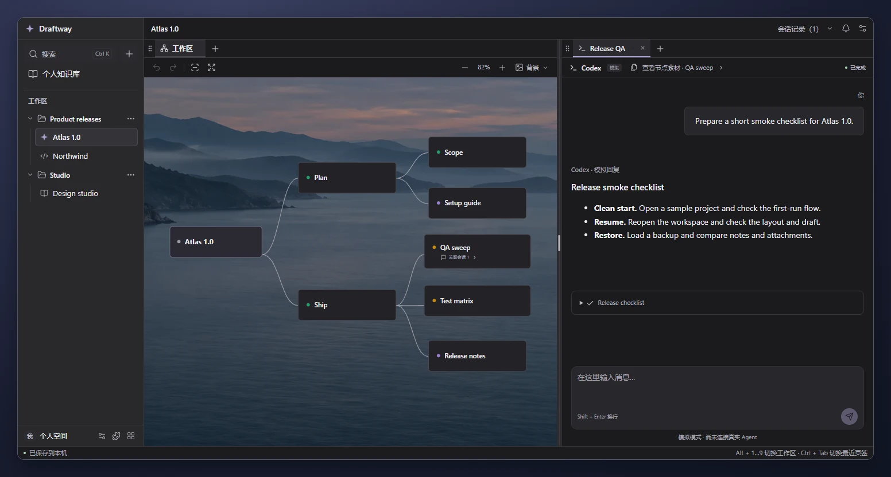
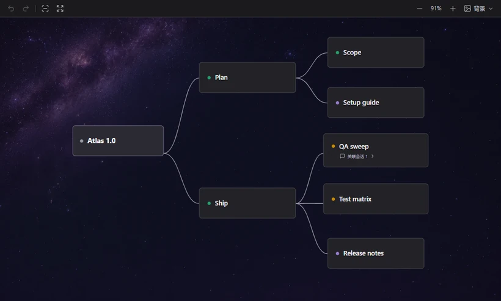
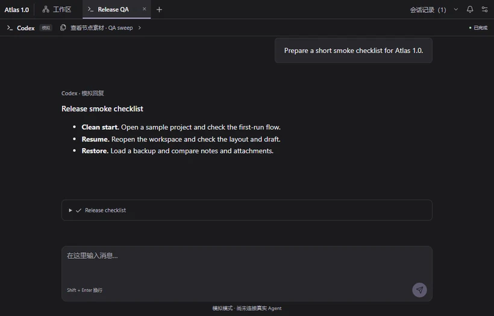
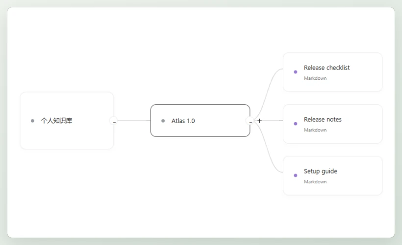

<h1 align="center">
   Draftway
</h1>

<p align="center">
  <strong>A local-first project workbench for you and your AI agents.</strong><br>
  Map a project, start an agent session from a node, and keep the notes and results with the work.
</p>

<p align="center">
  <a href="#quick-start"><strong>Get started</strong></a> ·
  <a href="#windows-desktop">Windows</a> ·
  <a href="docs/readme/README.zh-CN.md">简体中文</a> ·
  <a href="https://github.com/Tjh-UKN/draftway#start-of-content">★ Star</a>
</p>

<p align="center">
  <a href="docs/readme/workbench.webp"></a>
  <br><sub>Browser preview with a sample project and a simulated agent session. The current interface is in Simplified Chinese.</sub>
</p>

## What you can do

<table>
  <tr>
    <td width="43%" valign="middle">
      <h3>Organize workspaces and map projects</h3>
      <p>Group workspaces in the sidebar and drag them into place. Use map nodes for ideas, tasks, and documents. Each map remembers its grid, starry sky, or mountain-and-sea background.</p>
      <a href="docs/mindmap-editing.md">Map controls</a> · <a href="docs/materials.md">Linked materials</a>
    </td>
    <td width="57%">
      <a href="docs/readme/project-map.webp"></a>
    </td>
  </tr>
  <tr>
    <td width="43%" valign="middle">
      <h3>Work beside your agent</h3>
      <p>Open Codex, Claude Code, or Pi from a map node in the Windows app. Keep the map and conversation side by side, follow agent activity in the conversation, and reopen closed tabs from workspace session history.</p>
      <a href="docs/windows-delivery.md">Windows capabilities</a>
    </td>
    <td width="57%">
      <a href="docs/readme/agent-session.webp"></a>
    </td>
  </tr>
  <tr>
    <td width="43%" valign="middle">
      <h3>Keep the results</h3>
      <p>Find available files and links from linked sessions in Materials (素材区), then add selected items to Outputs (产出区). On a result card, choose 保留到地图 to create an artifact node. Artifact and document nodes with text join workspace notes in the searchable personal knowledge library.</p>
      <a href="docs/personal-knowledge.md">Personal knowledge library</a>
    </td>
    <td width="57%">
      <a href="docs/readme/knowledge-library.webp"></a>
    </td>
  </tr>
</table>

## Quick start

Clone the repository with Git and install dependencies with Node.js 20 or later.

```sh
git clone https://github.com/Tjh-UKN/draftway.git
cd draftway
npm ci
npm run dev
```

Open [the local browser preview](http://127.0.0.1:1420/next.html). It stores its own data and uses simulated agents.

1. Click **+** next to **搜索** (Search) and choose **新建工作区** to create a workspace or **新建分组** to create a group. Drag a workspace into a group to organize it.
2. Point at a map node and click its **+** to add a child. Use **背景** in the map toolbar to choose **网格** (Grid), **星空** (Starry sky), or **山海** (Mountains and sea).
3. Click the node's info button (**查看节点详情**) and choose **新建会话** to start a conversation linked to that node.

### Windows desktop

Install the Rust MSVC toolchain, Visual Studio's **Desktop development with C++** workload, and WebView2. Then build and launch from the same checkout.

```powershell
npm run desktop:next:build
.\src-tauri\target\debug\northstar.exe
```

Draftway uses the agent tools and credentials you have already set up locally. Run `npm run desktop:next:release` to build the Windows installer. [Windows delivery and verification](docs/windows-delivery.md)

## Your workspace data

The desktop app stores workspace state and session history locally in SQLite. You can export and restore full backups from settings. Agent requests use the provider and credentials configured in your local agent tool. [Backup and recovery](docs/backup-recovery.md)

## More

- [Workspace tools for agents (MCP)](docs/workspace-tools.md) · [Plugins](docs/plugins.md) · [Classic workbench guide](docs/classic-workbench.md) · [Room: message Claude Code sessions across machines](docs/room.md)
- [Report a bug or request a feature](https://github.com/Tjh-UKN/draftway/issues)
