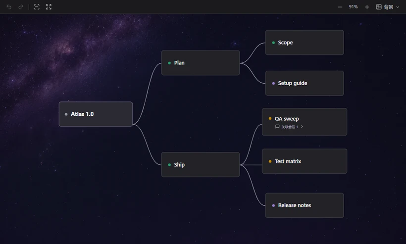
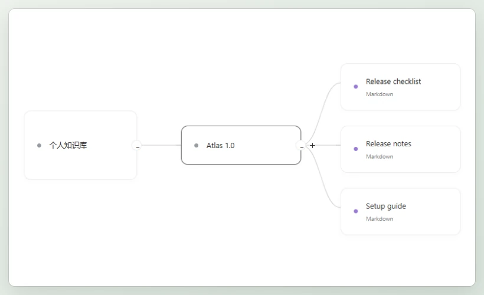

<h1 align="center">
   Draftway
</h1>

<p align="center">
  <strong>把项目地图、笔记和 AI 会话放在同一个本地工作台。</strong><br>
  从地图节点发起会话，在分屏里继续工作，把有用的结果留回项目。
</p>

<p align="center">
  <a href="#快速开始"><strong>快速开始</strong></a> ·
  <a href="#windows-桌面版">Windows</a> ·
  <a href="../../README.md">English</a> ·
  <a href="https://github.com/Tjh-UKN/draftway#start-of-content">★ 点星</a>
</p>

<p align="center">
  <a href="workbench.webp"></a>
  <br><sub>浏览器预览实拍，项目与会话为演示数据。</sub>
</p>

## 你可以用它做什么

<table>
  <tr>
    <td width="43%" valign="middle">
      <h3>在地图上拆项目</h3>
      <p>用节点组织想法、任务和文档，直接编辑标题和跟踪进度。把相关文件、网页或 Obsidian 笔记挂在对应节点上。</p>
      <a href="../mindmap-editing.md">地图操作</a> · <a href="../materials.md">关联材料</a>
    </td>
    <td width="57%">
      <a href="project-map.webp"></a>
    </td>
  </tr>
  <tr>
    <td width="43%" valign="middle">
      <h3>让会话跟着项目走</h3>
      <p>在 Windows 版中，从节点启动 Codex、Claude Code 或 Pi。分屏并排查看地图和会话，关掉页签后，仍可从工作区的会话记录里找回。</p>
      <a href="../windows-delivery.md">Windows 功能</a>
    </td>
    <td width="57%">
      <a href="agent-session.webp"></a>
    </td>
  </tr>
  <tr>
    <td width="43%" valign="middle">
      <h3>把做完的东西留下来</h3>
      <p>把有用的会话产物保留到地图。随记、有正文的文档节点和留存产物会进入个人知识库，和 Markdown、HTML、画板及思维导图一起整理和搜索。</p>
      <a href="../personal-knowledge.md">个人知识库</a>
    </td>
    <td width="57%">
      <a href="knowledge-library.webp"></a>
    </td>
  </tr>
</table>

## 快速开始

安装 Git 和 Node.js 20 或更高版本，克隆项目后启动预览。

```powershell
git clone https://github.com/Tjh-UKN/draftway.git
cd draftway
npm ci
npm run dev
```

打开[本地浏览器预览](http://127.0.0.1:1420/next.html)。新建工作区后，点击地图节点旁的 **+** 添加子节点，再从节点详情发起会话。浏览器预览使用独立存储和模拟 Agent。

### Windows 桌面版

安装 Rust MSVC 工具链、Visual Studio 的 **使用 C++ 的桌面开发** 工作负载和 WebView2 后，在同一目录构建并启动。

```powershell
npm run desktop:next:build
.\src-tauri\target\debug\northstar.exe
```

Draftway 使用本机已配置的 Agent 和登录凭据。运行 `npm run desktop:next:release` 可生成 Windows 安装包。[Windows 交付与验证](../windows-delivery.md)

## 本地数据

桌面版将工作区状态与会话历史保存在本机 SQLite，支持在设置中导出与恢复完整备份。Agent 请求使用本机执行器已配置的服务和凭据。[备份与恢复](../backup-recovery.md)

## 更多

- [Agent 工作区工具（MCP）](../workspace-tools.md) · [插件](../plugins.md) · [经典工作台使用手册](../classic-workbench.md)
- [反馈问题或提功能建议](https://github.com/Tjh-UKN/draftway/issues)
